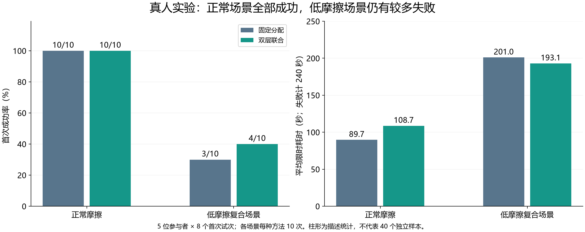
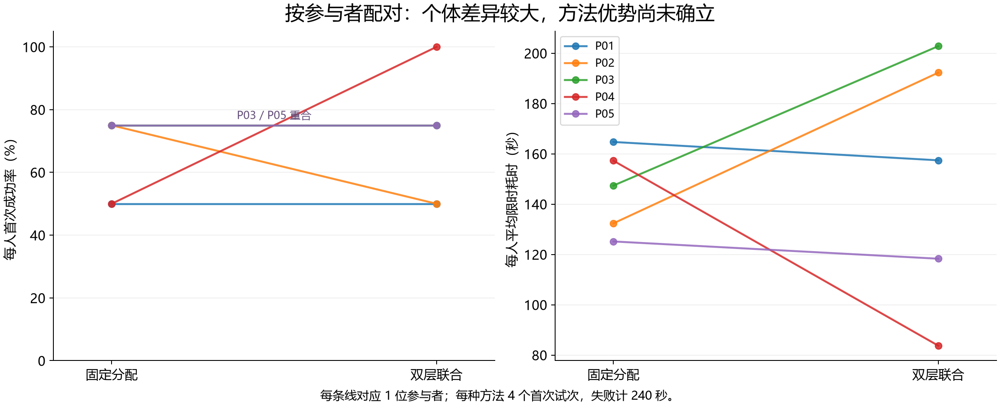
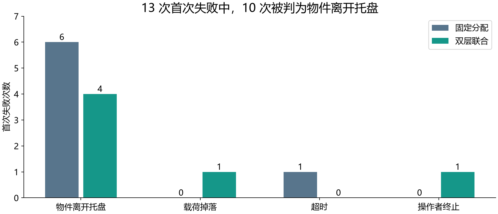

# 灵驭：真人双层风险实验分析

分析日期：2026-11-20（北京时间）。数据来源：冻结协议下的 Quest 3 WebXR 真人输入与 MuJoCo 仿真。

5 位参与者完成 40 个正式试次。固定分配首次成功 13/20（65%），双层联合 14/20（70%）；双层联合增加 1 次成功，但平均限时耗时从 145.4 秒变为 150.9 秒。当前数据未确立双层联合的整体优势。

## 分析口径

- 共 78 次正式尝试，其中 40 次首次尝试、38 次额外重试；14 个试次有重试。另有 19 次试跑，全部排除出正式统计。
- P01–P05均为项目团队成员，此前均未使用过VR；练习约10分钟。以上为负责人于2026-11-20采集后补充的信息，时长为约数，未提供逐人、分方法的计时，也未明确10分钟指合计还是每种方法。
- 每人 2 方法 × 2 场景 × 2 重复；目标台高统一 0.75 m，时限 240 秒。正常/低摩擦分别使用 9000/9001 和 9010/9011 种子，同场景、同重复的方法之间配对。
- 主分析按开始事件时间选择最早尝试；失败、超时、操作者终止及追踪中断均保留。此规则与已有汇总一致，但未在冻结协议中预注册，属于采集后确定的处理规则。
- 限时耗时：成功取 min(真实墙钟耗时, 240)，失败一律计 240 秒。成功试次耗时单独报告，不能代替含失败的主指标。
- 效率：每 600 秒计时窗口的成功次数；包含失败，排除练习、休息、场景加载。主分析只用首次尝试；含重试效率另外报告。
- 独立统计单位是参与者（n=5）。40 个试次和 78 次尝试都不是独立样本量。
- “低摩擦”是复合场景：夹持摩擦系数 1.1→0.55，承载面 0.8→0.16，物件偏置 0→3.5 cm，载荷倍率 1.0→1.15；场景差异不能归因于摩擦单因素。

## 主结果

|场景|方法|首次成功|成功率|平均限时耗时/s|成功试次平均耗时/s|每10分钟成功次数|
|---|---|---:|---:|---:|---:|---:|
|正常摩擦|固定分配|10/10|100%|89.73|89.73|6.69|
|正常摩擦|双层联合|10/10|100%|108.72|108.72|5.52|
|低摩擦复合场景|固定分配|3/10|30%|201.04|110.12|1.53|
|低摩擦复合场景|双层联合|4/10|40%|193.10|122.75|2.77|

合并场景：固定分配/双层联合的平均限时耗时为 145.38/150.91 秒，计时窗口汇总效率为 3.76/4.30 次/10分钟。效率是总成功数除以总时间，不等于先计算每人效率再平均。

## 每位参与者的配对结果

|参与者|固定成功|双层成功|成功率差/百分点|固定限时耗时/s|双层限时耗时/s|耗时差/s|
|---|---:|---:|---:|---:|---:|---:|
|P01|2/4|2/4|+0|164.72|157.42|-7.29|
|P02|3/4|2/4|-25|132.37|192.28|+59.91|
|P03|3/4|3/4|+0|147.39|202.80|+55.41|
|P04|2/4|4/4|+50|157.27|83.74|-73.53|
|P05|3/4|3/4|+0|125.16|118.31|-6.86|

所有差值均为“双层联合 − 固定分配”。正的成功率差有利于双层；正的耗时差表示双层更慢。

|探索指标|平均配对差|95% t区间|双侧符号翻转 p|
|---|---:|---:|---:|
|成功率/百分点|+5.00|[-29.00, 39.00]|1.0000|
|限时耗时/s|+5.53|[-62.52, 73.58]|1.0000|
|每人效率/次每10分钟|-0.02|[-3.20, 3.16]|1.0000|

区间按5位参与者的差值计算，依赖小样本正态近似；成功率区间未裁剪。符号翻转枚举2⁵种组合，依赖参与者差值在零假设下可交换符号的假设。冻结顺序为交错排程，并非随机分配；未做多重比较校正。这些数值只作探索，不能把不显著解释为等效，也不能用独立试次检验夸大证据。

## 重试与敏感性分析

|口径|固定成功|双层成功|固定限时耗时/s|双层限时耗时/s|固定效率|双层效率|
|---|---:|---:|---:|---:|---:|---:|
|首次尝试（主分析）|13/20|14/20|145.38|150.91|3.76|4.30|
|全部尝试（描述）|23/35|23/43|148.38|169.20|3.99|3.69|
|每试次最后一次（选择偏差示例）|20/20|20/20|97.70|108.07|6.14|5.55|
|配对双方均无追踪中断（事后敏感性）|11/16|13/16|138.66|134.38|5.24|5.09|
|剔除人为暂停的整对试次（事后敏感性）|13/19|14/19|140.40|146.22|5.28|4.42|

负责人补充说明：重试的主要原因是操作失误。这是对重试原因的总体回忆，未逐条对应38次额外重试；自动记录的失败类型仍原样保留，不能把每次失败都单独归因为操作者。操作失误属于本任务的人机交互表现，主分析仍保留首次失败。

重试并非等量、随机安排；既有失败后重试，也有成功后重试。后续首次试次可能已经受到前面额外练习的影响。首次尝试规则避免直接挑选成功结果，但无法消除整个流程中的学习与顺序影响。全部尝试只用于描述成本，最后一次结果用于展示选择偏差，均不能替代主分析。

|参与者/试次|方法/场景|按时间排序的结果（✓成功，×失败）|
|---|---|---|
|P01/1|固定分配/正常摩擦|✓ → ✓|
|P01/3|双层联合/低摩擦复合场景|× → × → ✓ → × → ✓ → ✓|
|P01/4|固定分配/低摩擦复合场景|× → ✓ → × → ✓|
|P01/5|固定分配/低摩擦复合场景|× → × → ✓ → × → ✓|
|P01/6|双层联合/低摩擦复合场景|× → × → ✓ → ✓|
|P02/2|双层联合/低摩擦复合场景|× → × → × → × → × → ✓|
|P02/3|固定分配/低摩擦复合场景|× → ✓|
|P02/7|双层联合/低摩擦复合场景|× → × → × → × → ✓|
|P03/1|双层联合/低摩擦复合场景|× → × → ✓|
|P03/7|固定分配/低摩擦复合场景|× → ✓|
|P04/1|固定分配/低摩擦复合场景|× → × → ✓|
|P04/8|固定分配/低摩擦复合场景|× → ✓|
|P05/3|双层联合/低摩擦复合场景|× → × → × → × → ✓|
|P05/4|固定分配/低摩擦复合场景|× → × → ✓|

## 失败、追踪与机制检查

首次失败共13次：物件离开托盘10次，超时、操作者终止、载荷掉落各1次。自动原因标签定位了失败类型；具体操作原因仍需结合录像，不把原因标签解释为控制算法的唯一因果责任。

|参与者/试次|方法/场景|追踪中断/s|结果|
|---|---|---:|---|
|P01/5|固定分配/低摩擦复合场景|15.41|failure|
|P02/5|固定分配/正常摩擦|8.96|success|
|P02/6|固定分配/低摩擦复合场景|8.91|success|
|P02/8|双层联合/正常摩擦|0.82|success|
|P05/3|双层联合/低摩擦复合场景|14.61|failure|

上述追踪中断均保留在主分析耗时与结果中；“双方无中断”仅是完整配对的事后敏感性分析。追踪状态指标不能覆盖服务进程停顿。

### 计时异常

|参与者/试次|墙钟耗时/s|仿真耗时/s|最大采样间隔/s|
|---|---:|---:|---:|
|P01/5|596.88|143.99|451.47|

P01/5出现约451秒采样停顿，超时判定延后到约597秒才写入。用户于2026-11-20确认当时“人为暂停或离开设备”（采集后补充，见现场补充记录.json）；采样停顿的底层机制未独立诊断。主分析保留首次失败，限时耗时计240秒，真实计时效率仍保留597秒。另在事后敏感性分析中剔除 P01/5 和相同场景、重复的双层 P01/6，共2次。不能把仿真143.99秒当成人的真实完成耗时，也不能把包含人为暂停的效率差完全归因于控制方法。

按试次窗口读取风险分配日志，以下为启用分配的平均仿真时长，供核对方法确实运行。不同方法和失败截断改变了暴露时长，不据此宣称风险降低。

|场景|方法|分配启用时长均值/s|
|---|---|---:|
|正常摩擦|固定分配|57.05|
|正常摩擦|双层联合|54.91|
|低摩擦复合场景|固定分配|46.71|
|低摩擦复合场景|双层联合|39.76|

## 数据核验与结论边界

- 78 次正式尝试的冻结哈希、方法、场景、重复、种子、台高、时限、配置/结果/事件对应关系已核对；当前采集源码与锁定源码一致。
- 40 个首次试次按开始/结束仿真时间截取轨迹，核对状态帧连续性、有限数与记录长度；未把试次结束后长时间空转计入结果。首次试次的风险日志同样仅统计试次窗口。
- 全部正式成功记录的终态支持力、撤手、目标位置、静止与物件留存条件已核对。连续1秒稳定来自冻结判定器记录；本轮未独立重放完整接触动力学，也未完成录像人工复核。
- WebXR来源、输入文件、设备自报信息均留存；`hardware_verified=false` 是现有元数据状态，不能把浏览器声明当成独立硬件验收。真人操作对象仍为仿真机器人，风险状态来自理想仿真量。
- 样本为5位无VR使用经验的团队成员，属于团队内便利样本，可提供小规模可行性和初步比较证据。团队身份可能影响对研究目的的熟悉程度与期望，不能当作独立招募的外部用户样本；也不能由“无VR经验”推断其无机器人或项目知识。
- 参与者背景、约10分钟练习与重试主要因操作失误，均来自负责人采集后的补充说明，见现场补充记录.json。逐人/分方法练习时长、逐次重试原因及录像同意状态仍未取得明确记录。
- 另有 59 个准备过但没有开始事件且无结果的正式配置目录，列在 audit.json；不计为试次。
- 已生成源文件SHA-256清单与逐次结果，便于回查；清单覆盖结果/配置/会话/事件/输入/模型，首次窗口NPZ哈希见 attempts.json，不代表对全部空转文件做了完整封存。

## 答辩建议表述

> 我们邀请了5位此前未使用过VR的项目团队成员，经过约10分钟练习，完成40个正式试次。按首次尝试，固定分配成功率65%，双层联合70%；正常场景两者均全部成功，低摩擦复合场景分别为30%和40%。额外重试主要因操作失误，主分析保留了首次失败。双层联合的平均限时耗时略长，个体差异较大，因此现阶段不能宣称新方法整体优于基线。这项团队内小样本实验验证了完整的人机交互与记录流程，也发现物件离开托盘仍是主要失败类型。下一步将统一重试与练习规则，招募团队外参与者，并在更接近真实传感条件下验证风险分配。

可主张：系统已运行、正式数据已采集、分析可追溯、方法局限已定位。尚不可主张：显著提升效率、已证明降低疲劳、真机闭环成功或算法普遍优越。腰部运动范围与离合次数可作辅助描述，不能代替疲劳量表或人体测量。

## 复现与文件

项目根目录运行 `.\.venv\Scripts\python.exe -X utf8 -m simulation.quest3.analyze_risk_final`。分析脚本只读取原始采集数据，输出到本目录。

- summary.json：条件汇总、每人配对、探索统计与敏感性分析。
- attempts.json：78次完整正式结果、来源路径、首次标记及40次轨迹核验。
- audit.json / source_manifest.json：审计结论与源文件哈希。
- 01–03 的 PNG/SVG：答辩插图；PNG可直接使用，SVG便于缩放。
