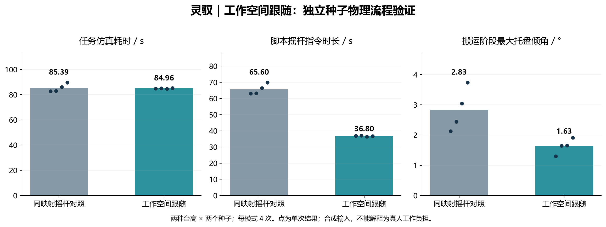
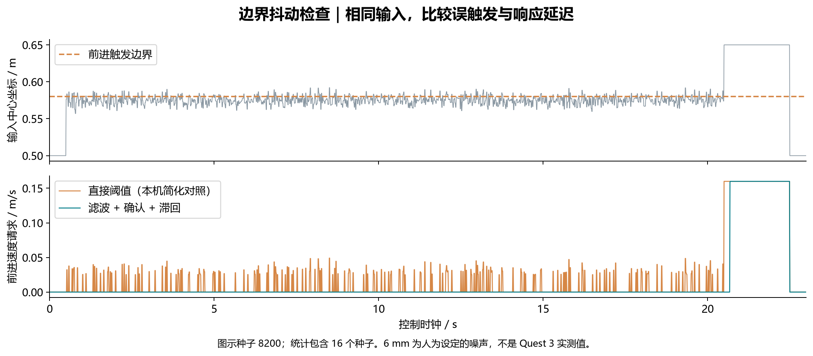

# 文献改进版验证结果

该版本依据 Let the Body Follow（2026，arXiv:2607.16095，式 5）的工作空间边界触发思路，针对本机差速底盘和共同持物任务独立实现。不是作者代码的完整复现。

## 实际实现

- 以离合标定时的真实双手中心为中点。前后超过 8 cm 才考虑生成前后速度；180 ms 确认、60 ms 滤波、1 cm 滞回，先回中再启用。
- 搬运时将前后手部修正限制在中点附近 ±1 cm，把较大伸手意图交给底盘；上下移动、共同偏航、夹爪仍由人控制。该任务映射适合共同持有刚性托盘，非任意双手操作。
- 搬运中短暂停车继续保持同一个腰部参考；收到超过 2 cm 的垂向目标变化、卸载或放置请求时才释放保持，避免每次停走重新寻找腰部姿态。
- 夹持、离台、倾角、滑移和放置阶段决定是否允许跟随；摇杆优先，松握键或输入失效停止指令。自动前后运动加入理想几何距离制动，转向及路线仍由人决定。
- 增加跟随状态、速度请求、底盘命令、原始手部中心及制动比例记录。

## 完整任务对照

| 指标 | 同映射摇杆对照 | 工作空间跟随 |
|---|---:|---:|
| 自动物理判据成功 | 4/4 | 4/4 |
| 平均任务仿真耗时 / s | 85.39 | 84.96 |
| 平均脚本摇杆指令时长 / s | 65.60 | 36.80 |
| 每次最大托盘倾角的均值 / ° | 2.83 | 1.63 |
| 每次最大相对滑移的均值 / mm | 10.09 | 10.48 |
| 每次腰部角度范围的均值 / ° | 1.61 | 1.84 |

场景为 60/75 cm 两种目标台高、每场景两个种子；合成操作器沿相同路线规划输入，两模式的手部/摇杆命令并不相同。输入在导航阶段叠加 6 mm 单轴手部位置噪声。保存全部结果，失败没有从表中删除。

摇杆指令时间下降是辅助功能的接口使用证据，不能等同于真人负担下降。每模式只有四次，不能据此宣称普遍可靠性或优于原论文。任务时间变长、倾角或滑移增加都应与减少摇杆操作一起报告。

最终这组数据中，跟随模式的摇杆指令时长下降约 43.9%；任务耗时均值相差不足 0.5 s，不作为显著提速结论。跟随模式最大托盘倾角较小，但最大滑移均值约增加 0.39 mm、腰部范围均值约增加 0.23°，因此不是所有指标都改善。

## 边界噪声消融

16 个噪声种子；每次先在阈值内侧 5 mm 保持 20 s，叠加 6 mm 高斯位置噪声，再明确前伸 2 s。两方法接收相同信号和相同载荷有效标记；这是控制器信号测试，不是物理位移测量。

| 指标（16 次均值） | 直接阈值 | 带确认的跟随 |
|---|---:|---:|
| 20 s 边界段的前进请求时长 / s | 4.117 | 0.000 |
| 前进请求启动次数 | 166.31 | 0.00 |
| 明确前伸后的请求响应延迟 / s | 0.000 | 0.180 |

该消融说明指定边界噪声下误触发减少，代价是确认延迟。它不意味着所有噪声下零误触发，也不是端到端 VR 延迟测量。

## 版本与边界

早期开发记录保留在 `follow_dev_20261117a/b/c/d`：a 为固定中点导致超时，b 为脚本切换抖动导致超时，c 为标定与操作器修正后成功，d 为缩小搬运手部修正后的开发试跑。

第一轮 `follow_validation_20261117` 的种子 7200–7201 用于发现并改进额外托盘倾斜，第二轮 `follow_validation_r2_20261117` 的种子 7300–7301 用于发现并改进短暂停顿导致的腰部解锁；两轮均已成为开发数据。最终修正版使用种子 7400–7401，运行前源码哈希见本目录上级 `protocol.json`，对应源码保存在 `source_snapshot`。各轮结果不能合并宣传为独立验证，也不以跨种子版本差异计算算法提升。

真实 Quest 3 对新版的操作舒适度、主观负担、误触发和完整成功率仍待预实验。近障制动依赖仿真理想几何，只限制自动前后移动，不能代替视觉避障、全身碰撞保证或实体机器人验证。未声称复现 MABEL、V-DART 或 ExtremControl。
